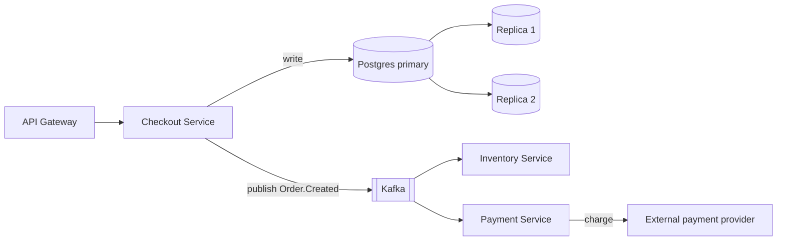

A design for an event-driven checkout system, fed to an agent, comes back in under a minute as a clean table. Component, failure mode, systemic impact, severity, likelihood, detection, a risk priority number, a mitigation. It looks like the output of a week of workshop time.

The part that should worry you is the scores. The agent put a 9 on replication lag and a 4 on payment retries. Why? Nothing in the design document says how often your replicas lag or how your payment provider behaves when it times out. Those numbers came from the model's sense of what such numbers usually are.

This is Part 3 of AI Agents for Staff+ Engineers. The thesis is narrow: agents are good at **enumerating** failure modes and bad at **scoring** them, so split the work that way. I'll show the prompt and output contract I'd use, then walk a Kafka and Postgres checkout example, including where the popular version of that example is wrong.

---

## What the research says about LLM-generated FMEA

FMEA, failure mode and effects analysis, comes from manufacturing and safety-critical engineering. There's a small but growing body of work on using LLMs for it, and the findings are consistent enough to plan around.

On the upside, a 2026 radiation-oncology case study used four LLMs to generate 190 candidate failure modes, 79 of them unique and usable. Three exceeded a risk threshold taken from a prior study ([Nair et al., Advances in Radiation Oncology](https://pubmed.ncbi.nlm.nih.gov/42254724/)). In an automotive case study, LLM-identified failure modes agreed with expert-identified ones at 80 to 91%, depending on the model ([Cambridge Design Science](https://www.cambridge.org/core/journals/design-science/article/aidriven-fmea-integration-of-large-language-models-for-faster-and-more-accurate-risk-analysis/22F110A2BF0DB4D01A69472CF17A0B43)). That matches how I'd expect a tireless reader of every component to behave: it doesn't get bored at component fourteen.

On the downside, the same literature keeps finding three problems:

- **Scores drift from the experts'.** In the radiation-oncology study, the LLMs rated severity higher than the experts did (7.3 against 4.1) and detectability worse (5.4 against 2.8), so mean risk priority numbers came out about three times higher (110 against 36). An SAE paper found extraction and categorization from architecture diagrams about 92% accurate, but scoring severity, occurrence and detection landed in a 70 to 90% band.
- **The model extrapolates.** A Cambridge Design Science paper notes that LLMs sometimes extend failure modes beyond what the input supports ([Cambridge](https://www.cambridge.org/core/journals/design-science/article/aidriven-fmea-integration-of-large-language-models-for-faster-and-more-accurate-risk-analysis/22F110A2BF0DB4D01A69472CF17A0B43)).
- **Output quality tracks input quality.** An SAE paper testing LLM-built FMEAs from architecture diagrams found results were sensitive to diagram complexity and quality, and that LLMs can't reliably create new detection measures ([SAE 2026-01-0106](https://saemobilus.sae.org/papers/ai-powered-failure-mode-effect-analysis-safety-critical-industry-2026-01-0106)).

These are small studies in medical and automotive settings, not software, so treat them as strong hints rather than proof. But they point at the same design: let the agent widen the net, and put humans on the judgement calls.

> **Principal Engineer's take:** The scoring step is where an FMEA turns from a list into a priority order, which is the whole reason to do one. It's also the step that needs your incident history, your traffic, your provider's actual behaviour and your team's operational maturity. An agent has none of those. If you let it score, you get a ranking that looks quantitative and is closer to a vibe.

---

## A note on the RPN itself

Before building on the severity × likelihood × detection multiplication, a caution: the risk priority number has known weaknesses even in manufacturing. The three scales are ordinal, not ratio, so multiplying them gives numbers that look precise and aren't. Quite different risk profiles can produce the same product. A severity of 10 with low likelihood can tie with a boring 5-5-4 failure.

My understanding is that the 2019 AIAG-VDA FMEA handbook moved away from ranking by RPN toward an "action priority" scheme for this reason. I haven't re-read the handbook for this post, so verify that before you cite it. Either way, if you use RPN, use it to sort a conversation and not to settle one. Severity deserves veto power: anything with data loss, double charging or security impact gets looked at regardless of its product.

---

## The setup: three layers of input

Since output quality tracks input quality, most of the work is in what you give the agent. Structure it as three layers.

**The design.** Text plus a diagram. Mermaid works well because the model can read it and you can version it. Include the sad paths: what happens on timeout, on retry, on partial failure. An agent can't enumerate failures in an interaction you didn't draw.

**The environment.** What it actually runs on: Kafka version and partition counts, Postgres topology, connection pool sizes, timeouts, who operates what. Defaults matter here. For example, the Kafka producer's `max.block.ms` defaults to 60 seconds and `delivery.timeout.ms` to two minutes, which has real consequences for a service calling `send()` on a request thread. Give the agent your configured values, not the vendor's.

**The constraints.** Your SLO, RPO and RTO, the operational maturity of the team, what's frozen or off-limits. These stop the agent proposing mitigations you can't run.

---

## The prompt and the output contract

The most useful change to the generic "FMEA prompt" you'll find online is to stop asking for a table of final scores and ask instead for structured claims with evidence. Here is a framework-agnostic version.

```text
You are reviewing a system design for failure modes. Do not assume
happy paths. Assume networks fail, downstream calls time out, disks fill,
and processes crash between any two statements.

For each component and each interaction in the design, list failure modes.
Cover at least: retry storms, replication lag and read-after-write,
dual writes and partial commits, blast radius and missing bulkheads,
cold start and autoscaling lag, and silent failures (unmonitored queues,
deadlocks, zombie processes).

For every failure mode return JSON with these fields:
  id, component, failure_mode, trigger,
  evidence: where in the provided design this follows from (quote it),
  assumptions: anything you assumed that the design does not state,
  local_impact, systemic_impact,
  existing_detection: what the design already has, or "none stated",
  severity_estimate: "low"|"medium"|"high"|"catastrophic" with one-line reason,
  mitigation_options: at least two, each with its operating cost,
  needs_human_data: what a person must supply to score this properly.

Rules:
- If a failure mode depends on a value not in the design (pool size,
  timeout, lag), say which value in needs_human_data. Do not invent it.
- Do not output numeric likelihood or detection scores.
- Separate transient (retryable) failures from poison-pill failures.
```

Two choices are deliberate. The `evidence` field makes the agent point at the design, which is how you catch extrapolation. And the `needs_human_data` field turns the model's gaps into a to-do list for you, instead of invented numbers.

Then a small deterministic check. This is the "brains and hands" split from Part 1 applied to the output:

```python
import json

REQUIRED = {"id", "component", "failure_mode", "trigger", "evidence",
            "assumptions", "systemic_impact", "severity_estimate",
            "mitigation_options", "needs_human_data"}

def validate(raw: str, design_text: str) -> tuple[list[dict], list[str]]:
    items, problems = json.loads(raw), []
    for it in items:
        missing = REQUIRED - it.keys()
        if missing:
            problems.append(f"{it.get('id', '?')}: missing {sorted(missing)}")
            continue
        # Evidence must be a verbatim quote from the design, not a paraphrase.
        if it["evidence"].strip() not in design_text:
            problems.append(f"{it['id']}: evidence not found in design")
        if len(it["mitigation_options"]) < 2:
            problems.append(f"{it['id']}: fewer than two mitigation options")
    return items, problems
```

The verbatim-quote check is blunt and will reject some good items that paraphrased. That trade is worth it. A false rejection costs one retry. A fabricated evidence quote that slips through costs you trust in the whole report.

---

## A worked example: event-driven checkout

The example here is a common one. An API gateway fronts a Checkout Service. Checkout writes to a Postgres cluster (one primary, two read replicas) and publishes `Order.Created` to Kafka. Inventory and Payment services consume it asynchronously. The target is 99.99% availability with a two-minute RTO.



I'm going to go through what an agent typically returns for this and then say what to keep, change or distrust. This is a composite walk-through of the standard analysis, not a transcript of a real run.

**1. The dual write. Keep it, and rank it first.** Checkout commits to Postgres and then publishes to Kafka as two separate steps. A crash between them leaves an order with no event. This is the classic dual-write problem and an agent reliably spots it. The standard fix is the transactional outbox: write the event to an outbox table in the same transaction as the order, then publish from the table.

Where the advice gets contested is the *how*. The common recommendation is Debezium reading the Postgres WAL via Kafka Connect. It's a legitimate and widely used approach, and it adds a Kafka Connect cluster and a logical replication slot to operate. A replication slot that nobody watches can retain WAL and fill the primary's disk. The alternative is a polling publisher that reads the outbox table from the application, which is less elegant and has fewer moving parts. Which is right depends on whether your team can already run Kafka Connect, and the agent can't know that.

**2. Kafka unavailable while the request thread waits. Keep, but verify the numbers.** The version of this finding that circulates says a Kafka partition exhausts the Checkout thread pool "within four seconds." I wouldn't repeat that figure. It depends on your request rate, your pool size, and whether `send()` blocks (it can, up to `max.block.ms`, 60 seconds by default). The failure mode is real. The timing is something you compute from your config. With an outbox in place this particular failure largely disappears, because the request no longer touches Kafka. That's a nice example of a mitigation to one item changing the severity of another, which a flat table hides.

**3. Replica lag and double-selling. Distrust as written.** The usual finding says Checkout reads inventory from a replica, serves stale data and double-sells. Look at the diagram, though. Inventory is a separate service consuming events. Checkout reading inventory state from its own replica doesn't follow from the design I drew. It follows from the agent's template. This is the extrapolation problem from the research, and it's what the `evidence` field is for. The real replica-lag risk here is narrower: a customer places an order and then reads their order status from a lagging replica and sees nothing. That's a read-your-writes issue, and the fix, route that read to the primary for a short window after writing, is cheap.

**4. Payment retries and idempotency. Keep.** If the Payment Service times out calling the provider and retries with a fresh request, the customer can be charged twice. The fix is an idempotency key generated at the edge and carried through to the provider. Stripe, for one, supports an `Idempotency-Key` header for exactly this, and other providers have equivalents.

**5. The circuit breaker finding. Keep, but check the mechanism.** The common write-up says a prolonged provider outage "locks upstream database connections" and takes down the primary. That only happens if the service holds a database transaction open while it calls out. Holding a transaction across a network call is itself the bug, and the better fix is to not do it, before any breaker. A circuit breaker (Resilience4j is a common JVM choice) is still worth having so the service fails fast instead of queueing, but the agent's causal story should be checked against how the code is really structured.

Notice the pattern. Out of five findings, two to keep with minor edits, two to rewrite because the mechanism was off, and one to restructure because the diagram didn't support it. That ratio comes from this one composite example, not a measurement, so don't generalize it. The point is that the list saves you enumerating everything by hand, and that a human still has to read each item. A list of ten things to check beats a blank page.

> **Principal Engineer's take:** Treat every finding as a hypothesis with a stated mechanism. The question to ask is "what would have to be true in our system for this to happen?" If the answer is a specific pool size, timeout, or code path, go and look. That's the 20% that matters, and no amount of prompting makes it go away.

---

## The scoring session, with people

Once you have a validated list, run the scoring as a short working session, not a solo read. Put the `needs_human_data` items on a shared page and fill them in before anyone assigns a number. For each item, ask:

- Has this happened to us, or to a team we know? Use your incident history before textbook likelihood.
- How would we find out, and how long would it take? Look at your dashboards and alerts, not the design's promises.
- What does it cost us, in money, customers or trust, if it hits at peak?

Score on a coarse scale. Three bands beat ten, because the precision in a 1 to 10 scale isn't real. Keep severity veto power over the sorted order. And record what you decided to accept, with an owner and a review date. An FMEA that ends in "mitigate everything" didn't prioritize anything.

`[YOUR STORY HERE: a real design review where an agent surfaced a failure mode you hadn't considered, or confidently described one that wasn't real. What was the system, what did you check, and what did it cost you in time? If you've scored risks with a team and found your gut and the agent's differed, that's worth a paragraph.]`

---

## What this costs

A long design, your environment details and a structured output with two or three mitigations per item is a lot of tokens, and the report is bigger than the input. Run one analysis and read the usage numbers before you decide to run it on every design. The cost pattern gets worse if you add the adversarial loop in the next part, since each round re-sends the whole design and the previous critique. Part 5 covers how to budget this. For now, measure one run and write the number down.

> **Principal Engineer's take:** The most valuable output of an agent-driven FMEA isn't the table. It's the `needs_human_data` list, which tells you exactly which facts about your own system you don't actually know. My bet is that's where the real risk lives, and an agent that points at your blind spots is worth more than one that fills them with numbers.

---

Next in the series: Part 4, **Adversarial Loops That Actually Disagree**. One agent proposes the design and mitigations, another attacks them. The research on this is mixed: debate can beat self-critique, and agents also tend to agree with each other and compound errors. I'll cover how to force real disagreement, when a loop isn't worth its cost, and a framework-agnostic implementation you can run yourself.

*Questions or pushback? Find me on [LinkedIn](https://www.linkedin.com/in/chaitanyamaili/).*
